# Cafetería asíncrona

Una cafetería universitaria donde pides desde el teléfono y la respuesta llega de inmediato: "pedido recibido, número 11". Desde ahí la cocina trabaja por su cuenta y el pedido avanza solo por `recibido`, `preparando` y `listo`. Nadie se queda mirando la pantalla mientras le preparan el café; la página consulta el estado cada pocos segundos y te avisa cuando puedes ir a recogerlo.

Para lograrlo, el backend no le pide nada a la cocina directamente. Guarda el pedido en Firestore, deja un mensaje en un tema de Pub/Sub y responde. Pub/Sub le entrega ese mensaje a la cocina, un servicio privado en Cloud Run que nadie más puede llamar. La plantilla trae las tres aplicaciones completas y la infraestructura del frontend y el backend; tu grupo construye en Terraform todo lo que conecta al backend con la cocina.

| Pedir | Seguir el pedido | Pantalla de la cafetería |
|---|---|---|
| 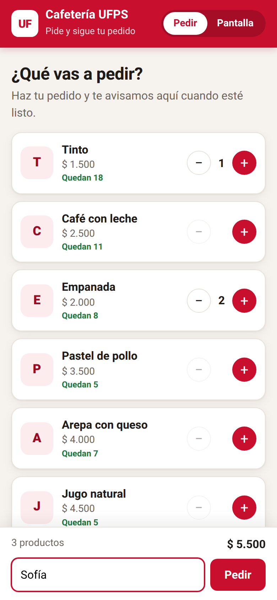 | 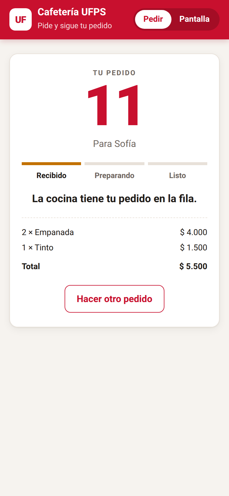 | 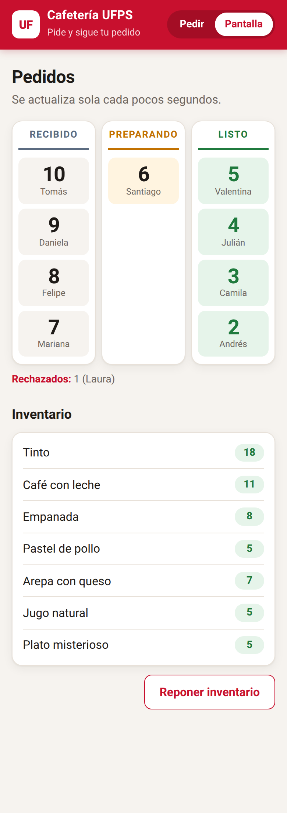 |

Si el frontend no logra hablar con el backend, lo dice en vez de quedarse en blanco:

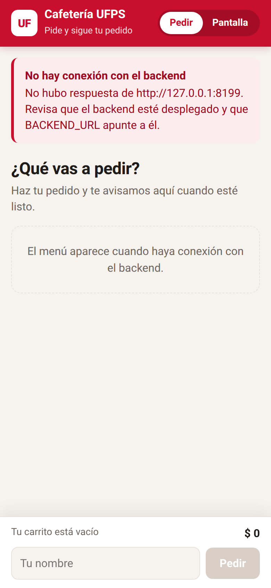

## Arquitectura al terminar la práctica

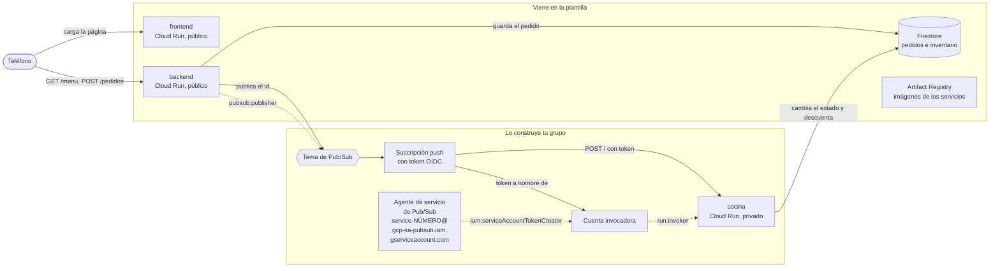

Las flechas punteadas son los permisos de IAM que da tu grupo. La etiqueta es el rol sin el prefijo `roles/` y la flecha llega al recurso sobre el que se da: el backend puede publicar solo en ese tema, el agente de Pub/Sub puede firmar tokens como la cuenta invocadora y esa cuenta puede invocar solo a la cocina.

En la plantilla, el backend ya sabe publicar, pero la variable `TEMA` está vacía: guarda el pedido, registra una advertencia y no avisa a nadie. Por eso, recién desplegada, la cafetería recibe pedidos que se quedan en `recibido` para siempre.

## Estructura del repositorio

```
backend/main.py            API en Flask: menú, pedidos, inventario y publicación en Pub/Sub
backend/requirements.txt   Dependencias del backend con versión fija
backend/Dockerfile         Imagen del backend con gunicorn
cocina/main.py             Worker que recibe las entregas push y prepara los pedidos
cocina/requirements.txt    Dependencias de la cocina con versión fija
cocina/Dockerfile          Imagen de la cocina con gunicorn
frontend/index.html        La página: vista para pedir y pantalla de la cafetería
frontend/server.py         Servidor sin dependencias que inyecta BACKEND_URL en la página
frontend/Dockerfile        Imagen del frontend
infra/providers.tf         Versión de Terraform y del proveedor de Google
infra/variables.tf         Proyecto, prefijo, región e imágenes
infra/main.tf              APIs, registro, Firestore, backend y frontend con sus cuentas
infra/outputs.tf           Ruta del registro y URL de los servicios
infra/terraform.tfvars.example   Ejemplo de valores; cópialo como terraform.tfvars
docs/api.md                Endpoints del backend y formato del mensaje de Pub/Sub
docs/estados.md            Ciclo de vida de un pedido y quién hace cada cambio
docs/capturas/             Capturas de la aplicación usadas en este README
.gitignore                 Deja por fuera el estado de Terraform, tus tfvars y __pycache__
```

## Cómo empezar

### Flujo de trabajo

1. Crea el repositorio de tu grupo con **Use this template** en GitHub.
2. Edita en VS Code o en github.dev (tecla `.` en la página del repositorio).
3. Haz commit y push desde el editor.
4. En Cloud Shell clonas la primera vez y traes los cambios con `git pull` después. Desde Cloud Shell nunca haces push.
5. Docker y Terraform se ejecutan siempre en Cloud Shell. La consola de Google Cloud es para mirar y diagnosticar, no para crear recursos.

### Primer despliegue

En Cloud Shell:

```bash
git clone https://github.com/<tu-usuario>/<tu-repositorio>.git
cd <tu-repositorio>/infra
cp terraform.tfvars.example terraform.tfvars
cloudshell edit terraform.tfvars
```

En `terraform.tfvars` pon el ID de tu proyecto y el prefijo del grupo, y ajusta las rutas de las imágenes a esos mismos valores. Este archivo vive solo en Cloud Shell: el `.gitignore` evita que llegue a GitHub.

El orden importa, porque las imágenes necesitan el registro y los servicios necesitan las imágenes:

```bash
# 1. Solo el registro (y las APIs de las que depende)
terraform init
terraform apply -target=google_artifact_registry_repository.registro

# 2. Las imágenes
REGISTRO=$(terraform output -raw registro)
gcloud auth configure-docker us-central1-docker.pkg.dev --quiet
cd ..
docker build -t $REGISTRO/backend:v1 backend
docker push $REGISTRO/backend:v1
docker build -t $REGISTRO/frontend:v1 frontend
docker push $REGISTRO/frontend:v1

# 3. Todo lo demás
cd infra
terraform apply
terraform output
```

Abre `url_frontend` en el teléfono. Si usas otra región, cambia `us-central1` en el comando de `gcloud auth configure-docker`.

Cuando cambies el código de un servicio, construye y sube la imagen con una etiqueta nueva (`v2`, `v3`...), actualízala en `terraform.tfvars` y vuelve a aplicar. Si subes otra vez la misma etiqueta, Terraform no ve ningún cambio y Cloud Run sigue con la versión anterior.

## Probar cada servicio con `docker run`

Antes de subir una imagen, pruébala en Cloud Shell. Para ver una página servida en Cloud Shell usa **Vista previa en la Web** y elige el puerto.

**Frontend.** No necesita credenciales:

```bash
docker run --rm -p 8080:8080 -e BACKEND_URL=https://<url-del-backend> $REGISTRO/frontend:v1
```

Abre la vista previa en el puerto 8080. Si no pasas `BACKEND_URL`, verás el mensaje de error de la captura de arriba.

**Backend sin Firestore.** El contenedor arranca aunque no tenga credenciales; la validación de pedidos no toca la base, así que puedes comprobarla:

```bash
docker run --rm -d --name backend -p 8081:8080 $REGISTRO/backend:v1
curl -i -X POST localhost:8081/pedidos -H 'Content-Type: application/json' -d '{"cliente": "Ana", "items": []}'
docker logs backend
docker rm -f backend
```

Debe responder `400` con el error en JSON.

**Backend con Firestore.** Cuando la base ya existe (después del primer `terraform apply` completo), puedes darle al contenedor tus propias credenciales:

```bash
gcloud auth application-default login
docker run --rm -d --name backend -p 8081:8080 \
  -e GOOGLE_CLOUD_PROJECT=<tu-proyecto> \
  -e BASE_DATOS=<prefijo>-cafeteria \
  -e GOOGLE_APPLICATION_CREDENTIALS=/adc.json \
  -v $HOME/.config/gcloud/application_default_credentials.json:/adc.json:ro \
  $REGISTRO/backend:v1
curl localhost:8081/menu
curl -X POST localhost:8081/pedidos -H 'Content-Type: application/json' \
  -d '{"cliente": "Ana", "items": [{"producto": "tinto", "cantidad": 1}]}'
```

**Cocina.** Escucha en `/` el mismo sobre que le entregaría Pub/Sub. Con las mismas credenciales, puedes hacerte pasar por Pub/Sub y entregarle a mano un pedido que esté en `recibido`:

```bash
docker build -t cocina cocina
docker run --rm -d --name cocina -p 8082:8080 \
  -e GOOGLE_CLOUD_PROJECT=<tu-proyecto> \
  -e BASE_DATOS=<prefijo>-cafeteria \
  -e GOOGLE_APPLICATION_CREDENTIALS=/adc.json \
  -v $HOME/.config/gcloud/application_default_credentials.json:/adc.json:ro \
  cocina
ID=<id de un pedido en recibido>
curl -i -X POST localhost:8082/ -H 'Content-Type: application/json' \
  -d "{\"message\": {\"data\": \"$(printf %s "$ID" | base64)\"}, \"deliveryAttempt\": 1}"
docker logs cocina
```

Responde `204` cuando termina, unos segundos después. Mira el pedido en la pantalla de la cafetería: acabas de hacer a mano lo que Pub/Sub va a hacer solo.

La cocina tiene dos variables para provocar fallas: `TIEMPO_PREPARACION` (segundos que tarda, 6 por defecto) y `PROBABILIDAD_FALLO` (entre 0 y 1; con esa probabilidad responde `500` después de haber terminado el trabajo). Los detalles están en [docs/api.md](docs/api.md) y el recorrido de un pedido en [docs/estados.md](docs/estados.md).

El plato misterioso falla siempre, y sin un tema de mensajes muertos Pub/Sub lo sigue reintentando mientras retenga el mensaje, que por defecto son 7 días. Cada intento deja un error en los logs de la cocina, así que se van a llenar hasta que tu grupo resuelva esa parte del reto.

---

# Informe del grupo

Grupo 2. Prefijo de los recursos: `jorge-adolfo`. Proyecto de quien despliega: `project-56eb9056-3ab4-4adb-b64`, región `us-central1`.

## Integrantes

| Nombre | Código | Usuario de GitHub |
|---|---|---|
| Jorge Reyes | | [JorgeAgar](https://github.com/JorgeAgar) |
| Adolfo Alejandro Arenas | | |

## URL de la cafetería

Frontend: https://jorge-adolfo-frontend-sq3337hevq-uc.a.run.app

Backend: https://jorge-adolfo-backend-sq3337hevq-uc.a.run.app · Cocina (privada, responde 403 sin token): https://jorge-adolfo-cocina-sq3337hevq-uc.a.run.app

Después de las pruebas se hizo `terraform destroy` para no dejar nada cobrando. Para la revisión se vuelve a levantar con los pasos de [Reproducir](#reproducir-desde-cero) y las URL quedan iguales, porque Cloud Run las arma con el nombre del servicio, el proyecto y la región.

## Diagrama propio

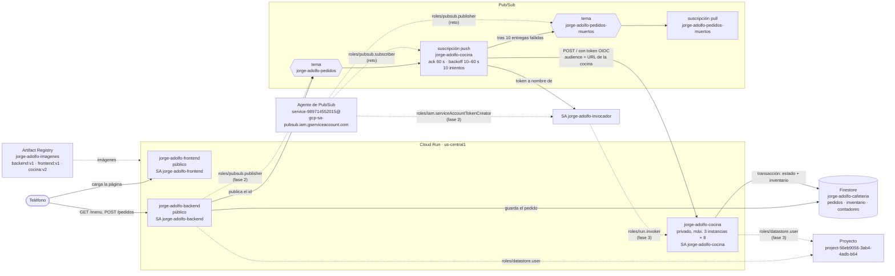

Las flechas punteadas con rol son permisos de IAM y llegan al recurso sobre el que se dan. Solo `datastore.user` se da sobre todo el proyecto; los demás están acotados a un tema, una suscripción, un servicio o una cuenta. La cocina no tiene ningún `run.invoker` para `allUsers`: esa ausencia es lo que la hace privada.

Todo está en [infra/main.tf](infra/main.tf) (plantilla, más la variable `TEMA` del backend) y en [infra/pubsub.tf](infra/pubsub.tf) (lo que construyó el grupo).

## Evidencias por fase

Las capturas están en [docs/capturas](docs/capturas) y las salidas completas de los comandos en [docs/evidencias](docs/evidencias). Las horas son UTC.

### Fase 0. Preparación

Repositorio: https://github.com/JorgeAgar/practica5-cafeteria-asincrona. Despliega Jorge, con su proyecto:

```
$ gcloud config list
[core]
disable_usage_reporting = True
project = project-56eb9056-3ab4-4adb-b64
```

### Fase 1. Registro, imágenes y la base

Primero `terraform apply -target=google_artifact_registry_repository.registro` (8 recursos: el registro y las APIs), luego las tres imágenes y después el `apply` completo (8 recursos más). Salida completa en [fase1.txt](docs/evidencias/fase1.txt).

```
IMAGE     TAGS  CREATE_TIME
backend   v1    2026-11-23 11:36
cocina    v1    2026-11-23 11:38
frontend  v1    2026-11-23 11:36
```

El primer pedido respondió `500`, como avisa la guía: el permiso del backend sobre Firestore todavía no se había propagado. El segundo respondió `201` y se quedó en `recibido`, con esta advertencia en los registros del backend:

```
2026-11-23T11:40:27.238629Z  WARNING:backend:TEMA está vacío: el pedido 9mkGjN1e2r54yLvhVKuF se guardó pero nadie le avisa a la cocina
```

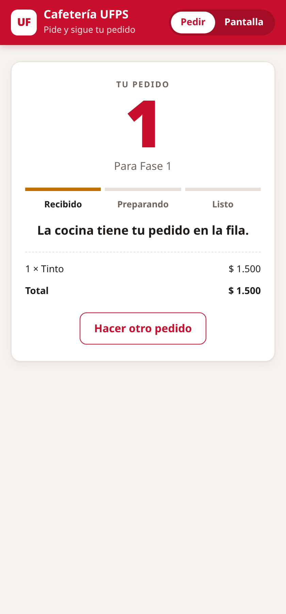

### Fase 2. El tema

[infra/pubsub.tf](infra/pubsub.tf) con el tema `jorge-adolfo-pedidos` y `roles/pubsub.publisher` para la cuenta del backend sobre ese tema, y `TEMA = google_pubsub_topic.pedidos.id` en el backend. Salida completa en [fase2.txt](docs/evidencias/fase2.txt).

```
2026-11-23T11:42:34.933620Z  INFO:backend:Pedido 6zus6GG7jj3YAw74Twa2 publicado en projects/project-56eb9056-3ab4-4adb-b64/topics/jorge-adolfo-pedidos

$ gcloud pubsub topics list-subscriptions jorge-adolfo-pedidos
Listed 0 items.
```

El pedido 2 se publicó, pero sigue en `recibido`: el tema no tenía suscripciones y lo descartó.

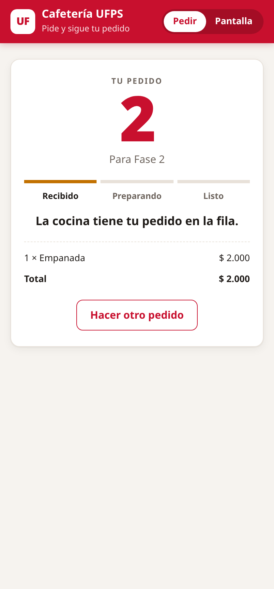

### Fase 3. La cocina privada

La cocina con su cuenta, la cuenta invocadora con `run.invoker` solo sobre la cocina, `iam.serviceAccountTokenCreator` para el agente de Pub/Sub sobre la cuenta invocadora y la suscripción push con token OIDC. Salida completa en [fase3.txt](docs/evidencias/fase3.txt).

| Preparando | Listo |
|---|---|
| 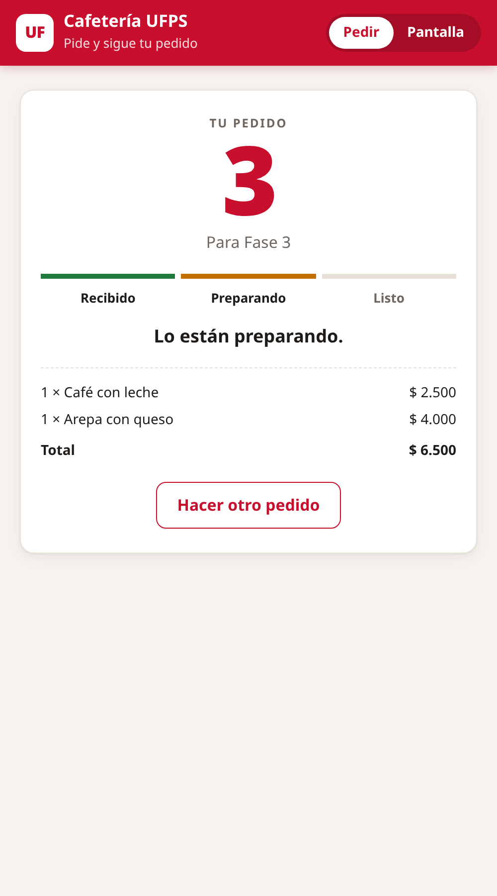 | 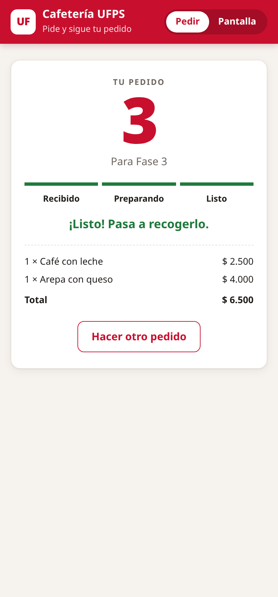 |

```
2026-11-23T11:45:37.654873Z  INFO:cocina:Pedido HjUyL2UaJPnhbN3TTGO6, intento de entrega desconocido
2026-11-23T11:45:44.083376Z  INFO:cocina:Pedido HjUyL2UaJPnhbN3TTGO6 listo
```

El primer pedido tardó unos 70 s en pasar a `preparando`. En el registro de solicitudes de la cocina se ve por qué: las cuatro primeras entregas de Pub/Sub recibieron `403` mientras se propagaba el `run.invoker`, y Pub/Sub reintentó con el backoff hasta que entró la quinta (`204`).

```
2026-11-23T11:44:27Z  403  POST  APIs-Google  The IAM principal lacks {run.routes.invoke} permission.
2026-11-23T11:44:40Z  403  POST  APIs-Google  ...
2026-11-23T11:44:58Z  403  POST  APIs-Google  ...
2026-11-23T11:45:15Z  403  POST  APIs-Google  ...
2026-11-23T11:45:36Z  204  POST  APIs-Google
```

Y el `curl` sin token:

```
$ C=$(terraform output -raw url_cocina)
$ curl -i -X POST $C/
HTTP/2 403
...
<title>403 Forbidden</title>
```

Ese rechazo no aparece en los registros de texto de la cocina, solo en `run.googleapis.com/requests`: `403  POST  curl/8.23.0  The request was not authenticated. ... Empty Authorization header value.` El pedido de la fase 2 sigue en `recibido`.

### Fase 4. Lo asíncrono, visto

Salida completa en [fase4.txt](docs/evidencias/fase4.txt). Los 60 pedidos respondieron `201`, todos entre las 11:47:12.2 y las 11:47:15.4 (3,2 s en total, con 0,146 s de latencia media). La cocina terminó el último a las 11:47:46.9.

| Unos segundos después de la ráfaga | Al terminar |
|---|---|
| 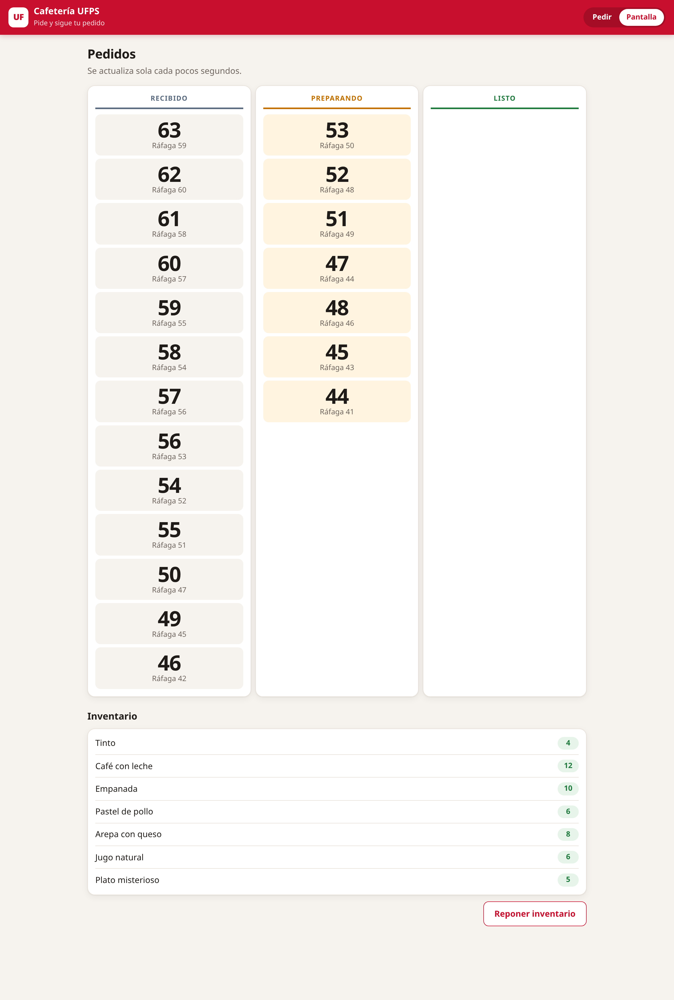 | 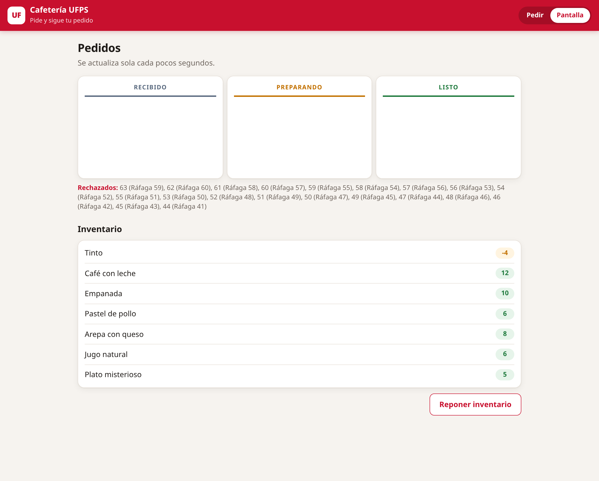 |

Los números no salen en orden (en la captura se preparan el 44, 45, 47, 48, 51, 52 y 53 mientras el 46 y el 49 siguen en fila). El inventario quedó así:

```
pedidos 'Ráfaga*': {'rechazado': 36, 'listo': 24} total 60
inventario: {..., 'tinto': -4}
```

**24 pedidos listos con 20 tintos, y el tinto en −4.** La cocina de la plantilla revisa existencias y descuenta en dos pasos, así que varios pedidos simultáneos vieron que alcanzaba antes de que alguno descontara.

Métricas ([fase4-metricas.png](docs/capturas/fase4-metricas.png), sacadas de Cloud Monitoring): la cocina pasó de 1 a 3 instancias, el máximo declarado. Pub/Sub hizo 51 entregas confirmadas en el minuto de la ráfaga y 9 en el siguiente. Hubo además 12 entregas fallidas con `500`. No las devolvió la cocina: fue Cloud Run, que con 3 × 8 pedidos ocupados respondió `The request was aborted after waiting too long for an available instance`. Pub/Sub las reintentó con el backoff y la cola quedó vacía unos 30 s después. La métrica `num_undelivered_messages` no tuvo puntos para ese minuto, así que la cola se ve en las entregas push.

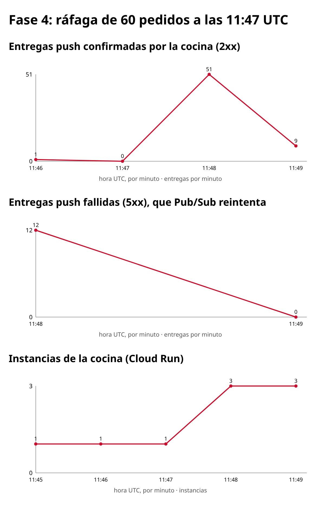

### Fase 5. Una falla a propósito

Con `PROBABILIDAD_FALLO = 0.5`, inventario repuesto y cuatro pedidos de un tinto. Salida completa en [fase5.txt](docs/evidencias/fase5.txt).

```
201 201 201 201
pedidos 'Prueba*': {'listo': 4} total 4
inventario: {..., 'tinto': 3}

      5 Pedido mirTbgufYGPGeWTOJ9Jb listo
      5 Pedido saVSxn5MbqpbWjP7bc0C listo
      2 Pedido wA7JGCDSUBOjCY8AzKwN listo
      5 Pedido yzjisATdbIjwHSs2vw7r listo
```

**Se descontaron 17 tintos por 4 pedidos** (de 20 quedaron 3, no 16). Fue una tirada de mala suerte: 13 fallas en 17 entregas, con una probabilidad de alrededor del 1 %. Registros de un pedido procesado cinco veces:

```
11:49:36.719  INFO:cocina:Pedido mirTbgufYGPGeWTOJ9Jb, intento de entrega desconocido
11:49:43.167  INFO:cocina:Pedido mirTbgufYGPGeWTOJ9Jb listo
11:49:43.167  WARNING:cocina:Falla simulada en el pedido mirTbgufYGPGeWTOJ9Jb: el trabajo quedó hecho pero no se confirma
11:49:55.716  INFO:cocina:Pedido mirTbgufYGPGeWTOJ9Jb, intento de entrega desconocido
11:50:01.874  INFO:cocina:Pedido mirTbgufYGPGeWTOJ9Jb listo
...
11:51:12.478  INFO:cocina:Pedido mirTbgufYGPGeWTOJ9Jb, intento de entrega desconocido
11:51:18.559  INFO:cocina:Pedido mirTbgufYGPGeWTOJ9Jb listo
```

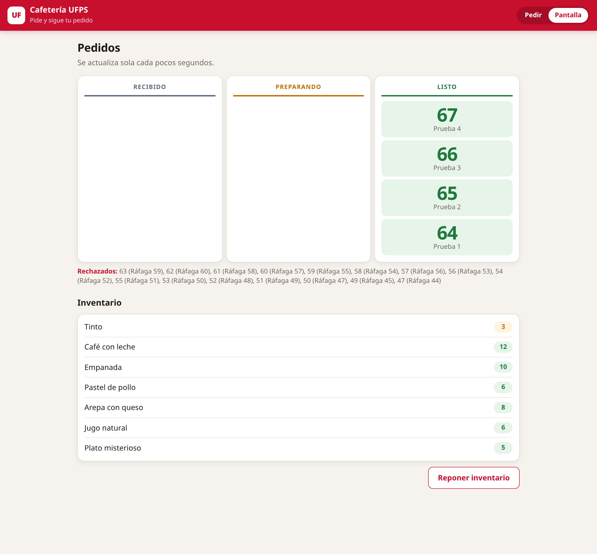

Al terminar se quitó el bloque de `PROBABILIDAD_FALLO` y se aplicó.

### Fase 6. Reto

- Idempotencia: [fase6-idempotencia.txt](docs/evidencias/fase6-idempotencia.txt)
- Mensajes muertos: [fase6-mensajes-muertos.txt](docs/evidencias/fase6-mensajes-muertos.txt)
- Mediciones: [fase6-mediciones.txt](docs/evidencias/fase6-mediciones.txt) y el script [medir.py](docs/evidencias/medir.py)
- Reproducción: [fase6-reproduccion.txt](docs/evidencias/fase6-reproduccion.txt)

**El inventario cuadra con la falla inyectada.** Con `PROBABILIDAD_FALLO = 0.5`, 20 pedidos de un tinto y 20 tintos:

| Cocina | Entregas | Promedio | Resultado | Tinto al final |
|---|---|---|---|---|
| Plantilla (`cocina:v1`) | 38 | 1,90 por pedido | 8 listos, **12 rechazados** | 0 (20 descontados por 8 pedidos) |
| Idempotente (`cocina:v2`) | 33 | 1,65 por pedido | **20 listos** | 0 (uno por pedido) |

**Entregas simultáneas del mismo pedido.** Se hicieron 10 pedidos de café con leche (había 12) y cada id se publicó 3 veces más en el tema, para tener 4 copias de cada pedido en vuelo a la vez. Hubo 48 entregas, los 10 pedidos quedaron listos y el café con leche quedó en 2: se descontaron exactamente 10. En los registros, un pedido con cuatro copias en tres instancias distintas:

```
12:05:47.136 inst …f421400a Pedido fUv56PRiWU7HhzUXWYk8, intento de entrega 1
12:05:49.214 inst …956c1fd8 Pedido fUv56PRiWU7HhzUXWYk8, intento de entrega 1
12:05:49.237 inst …f8b86a7e Pedido fUv56PRiWU7HhzUXWYk8, intento de entrega 1
12:05:49.240 inst …f8b86a7e Pedido fUv56PRiWU7HhzUXWYk8, intento de entrega 1
12:05:53.255 inst …f421400a Pedido fUv56PRiWU7HhzUXWYk8 listo
12:05:55.310 inst …956c1fd8 Pedido fUv56PRiWU7HhzUXWYk8 lo terminó otra entrega mientras tanto; no se descuenta otra vez
12:05:55.376 inst …f8b86a7e Pedido fUv56PRiWU7HhzUXWYk8 lo terminó otra entrega mientras tanto; no se descuenta otra vez
12:05:55.407 inst …f8b86a7e Pedido fUv56PRiWU7HhzUXWYk8 lo terminó otra entrega mientras tanto; no se descuenta otra vez
```

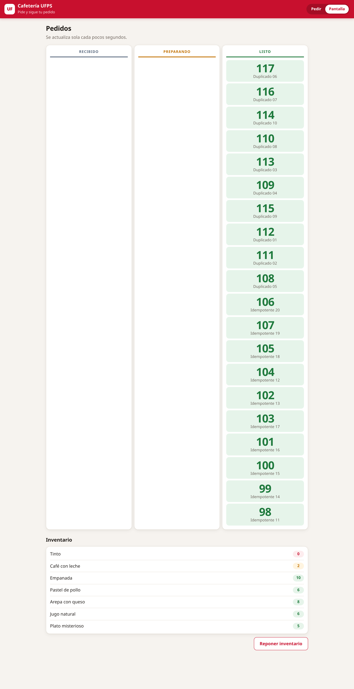

**Mensaje muerto del plato misterioso.** El pedido se hizo a las 12:09:40. La cocina lo recibió 10 veces, ya con `deliveryAttempt` (del `intento de entrega 1` a las 12:09:44 al `intento de entrega 10` a las 12:14:28), y después no hubo más intentos. Leído desde la suscripción del tema de muertos:

```
$ gcloud pubsub subscriptions pull jorge-adolfo-pedidos-muertos --auto-ack --limit=5
DATA                  MESSAGE_ID         ATTRIBUTES
WuHIHXnznjIgVKTx2Y7v  23442067211326230  CloudPubSubDeadLetterSourceDeliveryCount=10
                                         CloudPubSubDeadLetterSourceSubscription=jorge-adolfo-cocina
                                         CloudPubSubDeadLetterSourceTopicPublishTime=2026-11-23T12:09:40.389+00:00
```

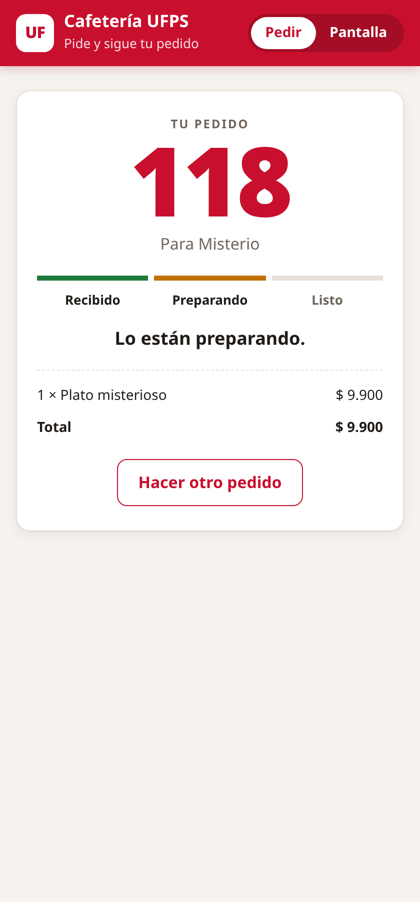

**Mediciones.** 60 pedidos a la vez, 3 repeticiones por configuración; el tiempo va desde el primer pedido creado hasta el último listo, con los timestamps de Firestore:

| Máx. instancias | Pedidos a la vez | Mínimo teórico | Último listo (3 repeticiones) | Mediana del último | Mediana de todos los pedidos | Entregas rechazadas por Cloud Run |
|---|---|---|---|---|---|---|
| 1 | 8 | 45 s | 66,6 · 76,1 · 80,8 s | 76,1 s | 35,8–41,2 s | 0 |
| 2 | 16 | 24 s | 37,3 · 38,2 · 48,6 s | 38,2 s | 17,2–26,5 s | 28 |
| 3 | 24 | 18 s | 50,2 · 33,1 · 52,4 s | 50,2 s | 12,6–29,3 s | 28 |
| 5 | 40 | 12 s | 51,4 · 30,4 · 28,0 s | 30,4 s | 7,3–13,5 s | 7 |

En todas las mediciones los 60 pedidos quedaron listos y el inventario quedó exacto: todo en 0 menos la arepa en 2 (8 − 6).

**Lecturas y escrituras de Firestore por pedido.** Para un pedido de un producto (k = 1) que llega una sola vez:

| Quién | Operación | Lecturas | Escrituras |
|---|---|---|---|
| backend, `POST /pedidos` | incremento del contador (`Increment`, sin leer) | 0 | 1 |
| backend, `POST /pedidos` | guardar el pedido | 0 | 1 |
| cocina, 1.ª transacción | leer el pedido y marcarlo `preparando` | 1 | 1 |
| cocina, 2.ª transacción | releer el pedido, leer k productos, descontar k y marcar `listo` | 1 + k | k + 1 |
| **Total (k = 1)** | | **3** | **5** |

En general son 2 + k lecturas y 4 + k escrituras. Cada entrega repetida de un pedido ya terminado cuesta 1 lectura más, y cada reintento de una transacción por contención repite sus lecturas. La cocina de la plantilla costaba 1 + k lecturas y 2 + k escrituras, pero las repetía completas en cada entrega. Aparte de eso está el frontend: el teléfono que sigue un pedido hace 1 lectura cada 5 s (`GET /pedidos/<id>`), y la pantalla de la cafetería, 20 + 7 lecturas cada 5 s (`GET /pedidos` y `GET /menu`).

**Reproducción desde cero.** Se hizo `terraform destroy` (29 recursos), se esperaron más de 5 minutos para que Firestore soltara el nombre de la base y se repitió todo solo con Terraform y Docker, sin tocar la consola. El detalle está en [Reproducir desde cero](#reproducir-desde-cero) y en [fase6-reproduccion.txt](docs/evidencias/fase6-reproduccion.txt). Volvieron a crearse los mismos 29 recursos (8 con `-target` y 21 con el `apply` completo), con las mismas URL. `terraform plan` quedó sin cambios, el primer pedido llegó a `listo` en 12 s, con las 2 empanadas y el tinto descontados, y la cocina siguió respondiendo `403` al `curl` sin token.

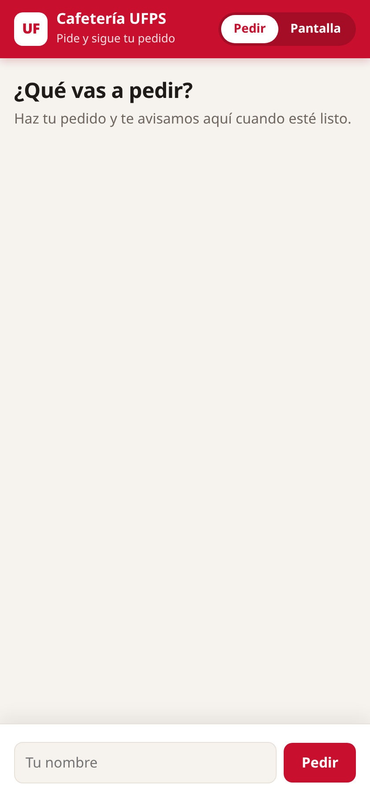

## Decisiones del reto

### Cómo sabe la cocina que un pedido ya se preparó

Consulta el campo `estado` del documento del pedido. `listo` y `rechazado` son estados finales, y [cocina/main.py](cocina/main.py) trabaja con dos transacciones de Firestore:

1. **`marcar_preparando`** lee el pedido y, solo si no está en un estado final, lo pasa a `preparando`. Si ya estaba terminado, responde `204` sin tocar nada: es una entrega repetida. Al ser transacción, una entrega tardía no puede devolver a `preparando` un pedido que otra ya dejó `listo`.
2. **`terminar`**, después de los 6 s de preparación, vuelve a leer el estado del pedido, lee las existencias de cada producto y, en el mismo commit, descuenta y marca `listo`, o marca `rechazado`. Revisar el estado, revisar las existencias y descontar quedan en una sola transacción, como pedía la pista.

Esto aguanta dos entregas simultáneas porque las transacciones de Firestore son serializables. Si dos copias del mismo pedido llegan a `terminar` a la vez, las dos leen el pedido en `preparando`, pero solo una puede confirmar. La otra choca con la escritura de la primera sobre el mismo documento, así que Firestore la aborta y la repite. En la repetición lee `listo` y sale como `"repetido"` sin descontar. Es lo que se ve en los registros de la prueba C: 4 copias en 3 instancias, un `listo` y tres `lo terminó otra entrega mientras tanto`. Por lo mismo se arregla el inventario negativo de la fase 4: dos pedidos distintos de tinto ya no pueden decidir con la misma lectura de existencias, porque el segundo en confirmar se repite y ve el valor nuevo. Se subió `max_attempts` de la transacción a 15 porque, con 20 pedidos de tinto a la vez, chocan mucho. Si aun así se agotan los intentos, la entrega responde `500` y Pub/Sub la reintenta, lo que es seguro.

### Cuántos intentos antes de rendirse

`max_delivery_attempts = 10`, con el backoff de 10 s a 60 s. Medido con el plato misterioso: del intento 1 al 10 pasaron unos 4 min 45 s.

Se descartó el mínimo de 5 por lo que vimos en las fases 3 y 4. Las fallas pasajeras de verdad gastan intentos: los 4 `403` mientras se propagaba el `run.invoker` y los 12 rechazos de Cloud Run por instancias llenas en la ráfaga (28 en algunas mediciones). Con 5 intentos, una ráfaga más grande o un permiso que tarda en propagarse podían mandar pedidos buenos a muertos. Con 10, un pedido que falla por algo pasajero tiene casi 5 minutos para recuperarse, y como la cocina es idempotente reintentar no cuesta inventario. El plato misterioso, que falla siempre, se rinde en 5 minutos y no en 7 días.

Si el problema dura más que eso, el mensaje pasa a `jorge-adolfo-pedidos-muertos` y el pedido se queda en `recibido` o `preparando`. No se pierde: el id queda guardado 7 días en la suscripción de muertos y se puede volver a publicar en el tema de pedidos cuando se arregle la falla. La cocina idempotente lo prepara sin riesgo de descontar dos veces.

### Los permisos de los mensajes muertos

- **`roles/pubsub.publisher` sobre el tema `jorge-adolfo-pedidos-muertos`.** Cuando un mensaje se rinde, quien lo reenvía al tema de muertos no es el backend ni la cocina: es el agente de servicio de Pub/Sub, a su nombre. Sin este permiso no podría publicarlo ahí.
- **`roles/pubsub.subscriber` sobre la suscripción `jorge-adolfo-cocina`.** Después de publicar la copia en el tema de muertos, el agente tiene que confirmar (ack) el mensaje original en la suscripción de origen para sacarlo de ahí. Sin este permiso el mensaje seguiría en la suscripción de la cocina.
- **Si faltara la suscripción en el tema de muertos**, pasaría lo mismo que en la fase 2: un tema no guarda nada, solo reparte copias a sus suscripciones. El mensaje muerto se publicaría en un tema vacío y se perdería sin dejar rastro, y además se habría confirmado en la suscripción de la cocina. Por eso `jorge-adolfo-pedidos-muertos` tiene su suscripción pull, con 7 días de retención y sin caducidad por inactividad.

### Cómo medimos

Usamos el script [docs/evidencias/medir.py](docs/evidencias/medir.py). Repone el inventario, lanza 60 `POST /pedidos` con 20 hilos (un producto por pedido, repartidos para que todos quepan en el inventario) y consulta Firestore cada 5 s hasta que los 60 terminan. Mide con los `creado` y `actualizado` que escriben el backend y la cocina, así que no depende del reloj del equipo que lanza los pedidos. Se hicieron 3 repeticiones por cada máximo de instancias (1, 2, 3 y 5), cambiando el máximo con `terraform apply -var cocina_max_instancias=N`, con `PROBABILIDAD_FALLO = 0` y `TIEMPO_PREPARACION = 6`.

Qué limitó el tiempo total:

- **El mínimo teórico** es `ceil(60 / (8 × instancias)) × 6 s`, más el arranque en frío de las instancias nuevas. El tiempo baja con más instancias, pero lejos de esa cuenta, y en ningún caso por debajo de unos 28 s.
- **Con 2 o más instancias manda la cola de reintentos.** Mientras las instancias nuevas arrancan, Cloud Run rechaza con `500` las entregas que no caben (28 en 3 repeticiones con 2 y con 3 instancias). Pub/Sub las reintenta con el backoff de 10 a 60 s, y los últimos pedidos salen en esa segunda o tercera tanda. Por eso la mediana de todos los pedidos baja mucho con las instancias (de 36–41 s a 7–13 s) mientras el último pedido varía tanto entre repeticiones (33 a 52 s con 3 instancias). Con 5 instancias hubo menos rechazos (7) y las dos últimas repeticiones, ya con las instancias calientes, terminaron en 28–30 s.
- **Con 1 instancia no hubo rechazos**, pero sí una sola fila de 8. Además Pub/Sub regula cuántas entregas push tiene abiertas según cuántas confirma, y las transacciones de los pedidos de tinto chocan entre sí y se repiten. Así se pasa de los 45 s teóricos a 67–81 s.

## Reproducir desde cero

Sin pasos en la consola, desde `infra/` y con `terraform.tfvars` lleno (proyecto, `prefijo = "jorge-adolfo"` y las tres imágenes, con `cocina:v2`):

```bash
terraform destroy                       # 29 recursos
# esperar ~5 minutos: Firestore no deja reutilizar enseguida el nombre de la base
terraform init
terraform apply -target=google_artifact_registry_repository.registro
REGISTRO=$(terraform output -raw registro)
gcloud auth configure-docker us-central1-docker.pkg.dev --quiet
cd ..
docker build -t $REGISTRO/backend:v1 backend   && docker push $REGISTRO/backend:v1
docker build -t $REGISTRO/frontend:v1 frontend && docker push $REGISTRO/frontend:v1
docker build -t $REGISTRO/cocina:v2 cocina     && docker push $REGISTRO/cocina:v2
cd infra
terraform apply
```

Las variables `cocina_max_instancias` (3 por defecto) y `cocina_probabilidad_fallo` (0 por defecto) solo se cambian con `-var` para las pruebas.

## Preguntas

**¿Por qué el pedido de la fase 2 nunca se preparó, aunque después crearon la suscripción?**
Un tema de Pub/Sub no guarda mensajes: en el momento de publicar, entrega una copia a cada suscripción que existe en ese instante, y cada suscripción guarda su copia hasta que la confirman. Cuando el backend publicó el pedido `6zus6GG7jj3YAw74Twa2` (11:42), el tema `jorge-adolfo-pedidos` no tenía ninguna suscripción, así que el mensaje se descartó de inmediato, aunque Pub/Sub le respondió al backend que lo había recibido. La suscripción `jorge-adolfo-cocina` se creó en la fase 3 (11:44) y solo recibe lo que se publica desde que existe. No hereda mensajes viejos, porque el tema no tenía retención configurada y nadie los guardó. Por eso el pedido 2 sigue en `recibido` aunque los pedidos posteriores sí avanzan.

**Si quitan el `run.invoker` de la cuenta invocadora, ¿qué deja de funcionar, cuánto tarda en notarse, qué ve el cliente en el teléfono y dónde encontrarían el error?**
Deja de funcionar la entrega de Pub/Sub a la cocina. El token OIDC sigue siendo válido, porque el agente todavía puede firmarlo, pero Cloud Run rechaza la petición con `403` antes de que llegue al código, porque la cuenta invocadora ya no puede invocar el servicio. No se nota enseguida: el cambio de IAM tarda uno o dos minutos en propagarse (vimos lo mismo al revés en la fase 3, con cuatro `403` durante 70 s). Además, al cliente no le falla nada. El frontend y el backend siguen públicos y el `POST /pedidos` responde `201` en una fracción de segundo con su número, porque el backend solo guarda y publica. En el teléfono el pedido se queda en `recibido` para siempre. Nunca pasa a `preparando`, porque la cocina no llega a ejecutarse, y la pantalla de la cafetería se va llenando de pedidos en la columna `recibido`. Pub/Sub reintenta cada mensaje con el backoff de 10 a 60 s, y con nuestra política de muertos, después de 10 intentos (unos 5 minutos) cada pedido termina en `jorge-adolfo-pedidos-muertos`, de donde habría que republicarlo al arreglar el permiso. El error no aparece en los registros de texto de la cocina, que se quedan callados. Está en el registro de solicitudes de la cocina, `run.googleapis.com/requests`, como `403 POST APIs-Google ... The IAM principal lacks {run.routes.invoke} permission`. También se ve en las métricas de la suscripción: `push_request_count` con `response_code = url_4xx_error_403`, `oldest_unacked_message_age` creciendo y luego mensajes llegando al tema de muertos. Los registros del backend siguen diciendo `publicado`, lo que confirma que la falla está entre Pub/Sub y la cocina.

**Con `PROBABILIDAD_FALLO` en 0.5, ¿cuántas veces le llega en promedio un mismo pedido a la cocina, con la cocina de la plantilla y con su cocina idempotente? Expliquen por qué los dos números son distintos y compárenlos con lo que midieron.**
Con la plantilla, cada entrega, sea la primera o una repetida, prepara el pedido de nuevo y después tira la moneda: con probabilidad 0,5 responde `500` y Pub/Sub lo vuelve a entregar. El número de entregas sigue una distribución geométrica con éxito 0,5, así que el promedio es 1 / 0,5 = **2 entregas** por pedido, y cada una descuenta inventario. Con la cocina idempotente, la primera entrega prepara y tira la moneda igual (0,5 de responder `500`). Pero una entrega repetida encuentra el pedido en `listo` en la primera transacción y responde `204` antes de llegar a la falla simulada, que solo ocurre después de hacer el trabajo. Entonces son 1 entrega con probabilidad 0,5 y 2 con probabilidad 0,5: **1,5 entregas** en promedio, y nunca más de 2. Los números son distintos porque en la plantilla cada reentrega vuelve a exponerse a la falla y la idempotente no. Lo medido: con la plantilla, 38 entregas para 20 pedidos (**1,90**, máximo 4 por pedido), y en la fase 5, 17 para 4 (4,25, una muestra chica y con mala suerte, alrededor del 1 % de probabilidad). Con la idempotente, 33 entregas para 20 pedidos (**1,65**, y ningún pedido pasó de 2, como predice la cuenta). Las diferencias con 2 y 1,5 caben en el ruido de 20 pedidos: la desviación estándar del promedio es de unas 0,3 entregas para la plantilla y 0,11 para la idempotente. Lo importante es la consecuencia: con la plantilla, 20 tintos alcanzaron para solo 8 pedidos, y con la idempotente, para los 20.
